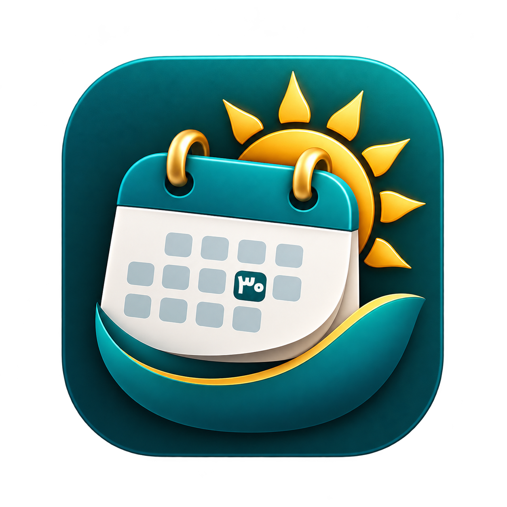

<div align="center">



# روزنما · Rooznama

**تقویم شمسی سبک برای system tray ویندوز**
*A lightweight Shamsi (Jalali) calendar for the Windows system tray*

[](https://github.com/Abulhallaj/rooznama/actions/workflows/build.yml)
[](LICENSE)

[فارسی](#فارسی) · [English](#english) · [Changelog](CHANGELOG.md)

</div>

<!-- Add screenshots to docs/screenshots and link them here -->

---

## فارسی

> وضعیت: در حال توسعه (نسخه ۰٫۵٫۰). هنوز روی همه نسخه‌های ویندوز آزمایش نشده است.

روزنما روز شمسی را به‌صورت عدد روی آیکون tray نشان می‌دهد؛ با نگه‌داشتن ماوس تاریخ دقیق شمسی و میلادی دیده می‌شود و با کلیک یک تقویم شمسی شبیه تقویم ویندوز ۱۱ باز می‌شود.

### امکانات
- آیکون tray با عدد روز شمسی (رنگ قابل تنظیم) و tooltip شمسی و میلادی
- تقویم بازشونده کنار tray: پس‌زمینه acrylic، انیمیشن، نمای روز / ماه / سال، روزهای ماه قبل و بعد به‌صورت کم‌رنگ، و تاریخ میلادی با هاور روی هر روز
- پنجره اصلی: تقویم بزرگ با روز میلادی کنار هر روز، مبدل تاریخ شمسی ↔ میلادی، تنظیمات، درباره
- فارسی (پیش‌فرض) و انگلیسی، فونت وزیرمتن، تم خودکار / روشن / تیره
- اجرا با ویندوز (اختیاری)

### پیش‌نیازها (برای کاربران)
روزنما به‌صورت **Framework-dependent** منتشر می‌شود؛ یعنی Runtimeها همراه فایل ZIP نیستند و باید یک بار روی سیستم نصب شوند. قبل از اجرای برنامه، این دو مورد را نصب کنید:

1. **Windows App Runtime** (نسخه ۱.۷ یا جدیدتر)
   - [دانلود از سایت مایکروسافت](https://learn.microsoft.com/windows/apps/windows-app-sdk/downloads)
   - فایل `WindowsAppRuntimeInstall-x64.exe` را از بخش «Windows App SDK Runtime» دانلود و نصب کنید.
2. **.NET 8 Desktop Runtime** (نسخه x64)
   - [دانلود از سایت مایکروسافت](https://dotnet.microsoft.com/download/dotnet/8.0)
   - از بین گزینه‌ها، **.NET Desktop Runtime 8.x** را انتخاب کنید (نه فقط Runtime معمولی).

> **نسخه ویندوز:** ویندوز ۱۰ نسخه ۱۸۰۹ یا بالاتر (بهترین تجربه روی ویندوز ۱۱).
>
> **نکته:** در نسخه‌های بعدی، یک نصب‌کننده (Installer) ارائه می‌شود که این پیش‌نیازها را به‌طور خودکار نصب می‌کند. تا آن زمان، نصب دستی لازم است.

### اجرا
1. از بخش [Releases](https://github.com/Abulhallaj/rooznama/releases) فایل ZIP را دانلود و در یک پوشه (مثلاً `C:\Program Files\Rooznama` یا هر جای دلخواه) باز کنید.
2. مطمئن شوید هر دو پیش‌نیاز بالا نصب شده‌اند (یک بار کافی است).
3. `Rooznama.exe` را اجرا کنید. آیکون در system tray ظاهر می‌شود (در ویندوز ۱۱ ممکن است داخل overflow باشد؛ به نوار بکشیدش).

اگر برنامه اجرا نشد، ابتدا نصب بودن پیش‌نیازها را بررسی کنید و سپس فایل لاگ (`%AppData%\Rooznama\rooznama.log`) را ببینید.

### ساخت از سورس
پیش‌نیاز: ویندوز ۱۰ نسخه ۱۸۰۹ یا بالاتر، [.NET 8 SDK](https://dotnet.microsoft.com/download)، و ترجیحاً Visual Studio 2022 با workload «.NET desktop development».

```powershell
git clone https://github.com/Abulhallaj/rooznama.git
cd rooznama
dotnet run
# بیلد برای انتشار (Framework-dependent، نیازمند Runtime روی سیستم کاربر):
dotnet publish -c Release -r win-x64 --self-contained false -p:WindowsAppSDKSelfContained=false -p:SatelliteResourceLanguages=en;fa -o publish
# بیلد Self-contained (همه چیز همراه برنامه، حجم بیشتر، بدون نیاز به نصب Runtime):
# dotnet publish -c Release -r win-x64 --self-contained -p:WindowsAppSDKSelfContained=true -p:SatelliteResourceLanguages=en;fa -o publish